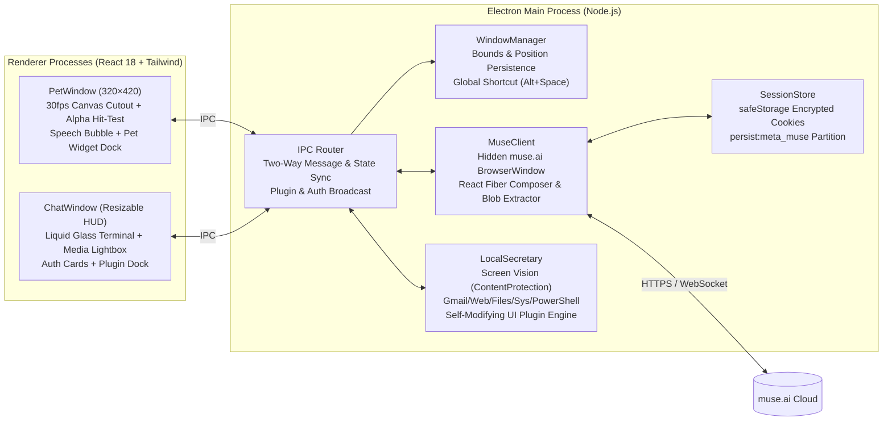

<div align="center">

# ✨ Muse Pet

**Desktop AI Companion, Liquid Glass Spotlight Terminal & Local PC Secretary for [Meta Muse](https://muse.ai)**

[](https://github.com/lzpzywoo/muse-pet/releases)
[](https://www.electronjs.org/)
[](https://react.dev/)
[](https://www.typescriptlang.org/)
[](#)
[](./LICENSE)

[**Overview**](#-overview) · [**Key Features**](#-key-features) · [**Architecture**](#️-system-architecture) · [**Commands**](#️-terminal-slash-commands) · [**Getting Started**](#-getting-started) · [**Releases**](https://github.com/lzpzywoo/muse-pet/releases)

</div>

---

## 📖 Overview

**Muse Pet** brings your custom AI companion (such as `Luna`) from [`muse.ai`](https://muse.ai) directly onto your desktop.

Instead of a static sticker or an intrusive rectangular widget, Muse Pet extracts your character's **multi-state 720p looping animations** (`default`, `working`, `resume`) and **high-res portrait** from your authenticated Meta Muse session, removes the white studio backdrop in real time at 30 FPS with **pixel-accurate alpha click-through**, and pairs her with an **Apple Liquid Glass Spotlight Terminal (`Alt + Space`)**, a **Level-2 Local PC Secretary Agent**, and a **Self-Modifying UI & Widget Plugin Engine**.

---

## ✨ Key Features

### 1. 🎭 Live Meta Muse Avatar & Pixel-Accurate Click-Through
- **Automatic Asset Synchronization**: Extracts multi-state 720p MP4 animations (`default` idle breathing, `working` thinking, `resume` talking) and 1600px WebP portraits from `muse.ai` and caches them locally under `userData/avatar_cache/`.
- **Real-Time Studio Backdrop Cutout**: Runs a 4-border-seeded BFS flood fill + 1–2px boundary color de-spilling algorithm at 30 FPS on `<canvas>`, removing the white studio background and circular backing plate while preserving interior whites (eyes, teeth, highlights).
- **Pixel-Level Alpha Hit-Testing**: Uses the live cutout mask (`bgMaskRef`) with `setIgnoreMouseEvents(true, { forward: true })`. Only opaque character pixels, active speech bubbles, or mounted widgets capture the mouse—all surrounding transparent pixels pass clicks straight through to your desktop and underlying windows.
- **Live Outfit Hot-Reload**: Automatically detects when you change your character's outfit or hairstyle on `muse.ai` and hot-reloads the desktop pet without restarting.

### 2. 🖥️ Spotlight Liquid Glass Terminal (`Alt + Space`)
- **Instant Quake / Spotlight Summon**: Press `Alt + Space` from any application or click the desktop pet to summon the terminal at the upper-center of your screen; press `Esc` to dismiss.
- **8-Direction Mouse Drag Resizing**: Freely resize the terminal from all 4 edges, 4 corners, or the bottom-right resize grip (or double-click the titlebar / click the green `+` traffic light to toggle expanded mode). Window dimensions and coordinates are automatically persisted.
- **Obsidian Solid & Liquid Glass Themes**: Defaults to **100% Opaque Obsidian Black** so background windows never bleed through text, while supporting `92%` Carbon, `72%` Crystal Glass presets, and a continuous `45% ~ 100%` opacity slider.
- **Rich Media & Two-Way Cloud Sync**: Synchronizes chat history, inline images (``), and videos (`<video>`) with Lightbox zoom preview across `muse.ai` and the desktop terminal, plus live speech bubble notifications and unread badges above the pet.

### 3. 🤖 Level-2 Local PC Secretary & Terminal Authorization
- **Flicker-Free Screen Vision (`/screen`)**: Captures a 1080p desktop screenshot while excluding `ChatWindow` and `PetWindow` via OS DWM `setContentProtection(true)` (zero window flicker or focus loss) and uploads it directly to your Muse companion for visual Q&A and UI/error diagnosis.
- **Web & Gmail Inspection (`/gmail`, `/web`)**: Opens an authenticated persistent browser window (`persist:secretary_browser`) to filter unread/important emails or summarize any webpage.
- **Local File & System Telemetry (`/find`, `/read`, `/clip`, `/sys`)**: Searches and reads local project files, inspects clipboard content, and reports CPU, RAM, disk, battery, and top running processes.
- **Human-in-the-Loop PowerShell Execution (`/ps`)**: Mutating actions or generated PowerShell scripts never execute silently—they render an inline **Terminal Authorization Card (`[Allow / Deny]`)** requiring explicit user approval.

### 4. 🧩 Self-Modifying UI & Live Widget Plugin Engine
- **Natural Language UI Evolution**: Ask Luna in plain language (e.g., *"Add a mini alarm clock widget"*, *"Switch to a cyberpunk neon theme"*, *"Add a sticky note"*, *"Give the pet a neon halo"*) or use `/plugin <prompt>`.
- **Plugin-Driven Widgets & Alarms**: Alarms, timers, sticky notes, and custom tools are dynamically synthesized and mounted on demand as lightweight widgets rather than bloating the core binary.
- **Dual-Window Hot Injection**: Dynamically injects scoped CSS (`chatCss`, `petCss`) and interactive HTML/JS widgets (`chatHtml`, `chatJs`, `petHtml`, `petJs`) across both `ChatWindow` and `PetWindow` with a sandboxed `sdk` (`addReminder`, `notify`, `playBeep`, `storage`, `sendCommand`).
- **One-Click Rollback & Safety Reset**: Every applied UI change renders an inline **Plugin Control Card** to toggle or uninstall it immediately, plus `/reset-ui` to restore default appearance at any time.

---

## 🏗️ System Architecture



---

## ⌨️ Terminal Slash Commands

| Command | Category | Description |
| :--- | :--- | :--- |
| `/plugin <request>` | UI Engine | Generate & hot-mount a custom UI theme or interactive widget (alarm clock, sticky note, halo, etc.) |
| `/plugins` | UI Engine | Open the installed UI & widget plugin manager in `/settings` |
| `/reset-ui` | UI Engine | Disable all custom themes/widgets and restore default UI |
| `/screen [question]` | Secretary | Capture clean desktop screenshot (excluding Pet/Terminal) for visual Q&A |
| `/gmail [filter]` | Secretary | Open Gmail in persistent secretary browser (`unread`, `starred`, or query) |
| `/web <url>` | Secretary | Open webpage, extract readable text, and summarize with Luna |
| `/find <keyword>` | Secretary | Search local files across Desktop, Documents, Downloads, or Workspace |
| `/read <path>` | Secretary | Read a local text/code file and send context to Luna |
| `/clip [question]` | Secretary | Read system clipboard text and analyze/translate/explain it |
| `/sys` | Secretary | Inspect real-time OS telemetry (CPU, memory, disks, battery, top processes) |
| `/ps <script>` | Secretary | Create an inline `[Allow / Deny]` approval card to run PowerShell |
| `/theme` / `/solid` / `/glass` | Appearance | Switch between Obsidian (`100%`), Carbon (`92%`), and Crystal (`72%`) |
| `/sync` | Cloud | Force-sync cloud chat history, rich media, and avatar assets from `muse.ai` |
| `/login` | Auth | Open or verify the `muse.ai` authentication session |
| `/settings` / `/proxy` | System | Toggle the visual settings drawer (Opacity, Proxy, Plugins) |
| `/clear` / `/exit` | System | Clear terminal screen or hide terminal window (`Esc`) |

---

## 🚀 Getting Started

### Option 1: Download Prebuilt Release
Download the latest Windows portable package from the [**GitHub Releases**](https://github.com/lzpzywoo/muse-pet/releases) page, extract it, and run `Muse Pet.exe`.

### Option 2: Build from Source

#### Prerequisites
- **Node.js** `>= 18.0.0` (LTS recommended)
- **npm** `>= 9.0.0`
- A [Meta Muse (`muse.ai`)](https://muse.ai) account

#### Install & Run in Development
```bash
# 1. Clone the repository
git clone https://github.com/lzpzywoo/muse-pet.git
cd muse-pet

# 2. Install dependencies
npm install

# 3. Start Vite + Electron in development mode
npm run dev
```

#### Build & Package for Production
```bash
# Typecheck and build renderer + main + preload bundles
npm run build

# Start built application locally
npm start

# Package distributable application (outputs to release/)
npm run dist
```

---

## 🔒 Security & Privacy

- **Encrypted Credential Storage**: Session cookies are encrypted at rest using Electron's OS-backed `safeStorage` (Windows DPAPI / macOS Keychain).
- **Strict Read/Write Separation**: Read-only queries (`/sys`, `/find`, `/read`, `/clip`, `/screen`) run directly, whereas any PowerShell command or system state mutation (`/ps`) requires explicit human approval via an inline `[Allow / Deny]` card.
- **Sandboxed UI Plugins**: Dynamic widgets execute with a restricted `sdk` object (`addReminder`, `notify`, `playBeep`, `storage`, `sendCommand`) and have no direct access to Node.js or Electron internals.

---

## 📁 Project Structure

```text
muse-pet/
├── src/
│   ├── main/
│   │   ├── index.ts             # Electron app lifecycle, single-instance lock, startup orchestration
│   │   ├── window-manager.ts    # PetWindow & ChatWindow creation, bounds persistence, Alt+Space shortcut
│   │   ├── muse-client.ts       # Hidden muse.ai driver, React Fiber composer, avatar & media extractor
│   │   ├── local-secretary.ts   # Screen vision, Gmail/Web, Files/Sys/PS & Self-Modifying UI plugin engine
│   │   ├── ipc-handlers.ts      # IPC routing, cloud sync merger, authorization & plugin broadcasting
│   │   ├── session-store.ts     # safeStorage (DPAPI/Keychain) encrypted cookie persistence
│   │   ├── proxy-manager.ts     # HTTP/SOCKS5 proxy configuration across Electron sessions
│   │   └── tray.ts              # System tray menu & window controls
│   ├── preload/
│   │   ├── pet.ts               # ContextBridge API for PetWindow (hit-test, drag, avatar, plugins)
│   │   └── chat.ts              # ContextBridge API for ChatWindow (stream, resize, secretary, plugins)
│   ├── renderer/
│   │   ├── pet/App.tsx          # 30fps cutout canvas, pixel alpha hit-testing, speech bubble, pet dock
│   │   ├── chat/App.tsx         # Liquid Glass terminal, 8-way resize, media lightbox, auth & plugin cards
│   │   └── index.css            # Apple Liquid Glass styles & terminal animations
│   └── types/
│       └── index.ts             # Shared TypeScript interfaces & IPC contracts
├── LICENSE                      # MIT License
└── README.md                    # Project documentation
```

---

## 📄 License

Released under the [MIT License](./LICENSE). Copyright © 2026 [remy (lzpzywoo)](https://github.com/lzpzywoo).
