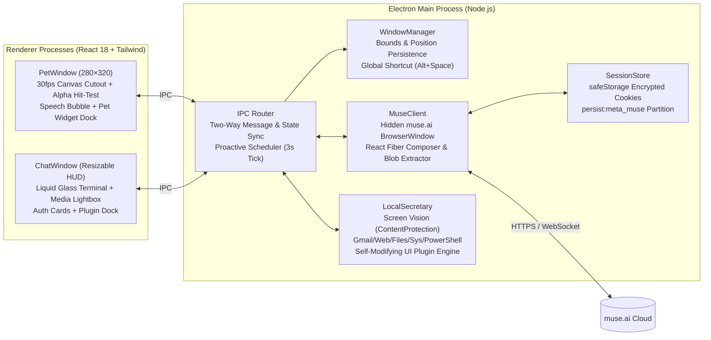

<div align="center">

# ✨ Muse Pet

**Desktop AI Companion, Liquid Glass Spotlight Terminal & Local PC Secretary for [Meta Muse](https://muse.ai)**  
**专为 Meta Muse 打造的透明桌面 AI 伴侣、液态玻璃快捷终端与本地电脑小秘书**

[](https://github.com/lzpzywoo/muse-pet/releases)
[](https://www.electronjs.org/)
[](https://react.dev/)
[](https://www.typescriptlang.org/)
[](#)
[](./LICENSE)

[**English**](#english-documentation) · [**简体中文**](#中文文档) · [**中文独立文档 (README_CN.md)**](./README_CN.md) · [**Releases / 下载安装包**](https://github.com/lzpzywoo/muse-pet/releases)

</div>

---

<a id="english-documentation"></a>

## 📖 Overview

**Muse Pet** liberates your custom AI companion (such as `Luna`) from the browser tab on [`muse.ai`](https://muse.ai) and brings her directly onto your desktop.

Instead of a static sticker or an intrusive rectangular widget, Muse Pet extracts your character's **multi-state 720p looping animations** (`default`, `working`, `resume`) and **high-res portrait** directly from your authenticated Meta Muse session, removes the white studio backdrop in real time at 30 FPS with **pixel-accurate alpha click-through**, and pairs her with an **Apple Liquid Glass Spotlight Terminal (`Alt + Space`)**, a **Level-2 Local PC Secretary Agent**, and a **Self-Modifying UI & Widget Plugin Engine**.

---

## ✨ Key Features

### 1. 🎭 Live Meta Muse Avatar & Pixel-Accurate Click-Through
- **Automatic Asset Synchronization**: Extracts multi-state 720p MP4 animations (`default` idle breathing, `working` thinking, `resume` talking) and 1600px WebP portraits from `muse.ai` and caches them locally under `userData/avatar_cache/`.
- **Real-Time Studio Backdrop Cutout**: Runs a 4-border-seeded BFS flood fill + 1–2px boundary color de-spilling algorithm at 30 FPS on `<canvas>`, removing the white studio background and circular backing plate while preserving interior whites (eyes, teeth, highlights).
- **Pixel-Level Alpha Hit-Testing**: Uses the live cutout mask (`bgMaskRef`) with `setIgnoreMouseEvents(true, { forward: true })`. Only opaque character pixels, active speech bubbles, or mounted widgets capture the mouse—all surrounding transparent pixels pass clicks straight through to your desktop and underlying windows.
- **Live Outfit Hot-Reload**: Automatically detects when you change your character's outfit or hairstyle on `muse.ai` and hot-reloads the desktop pet without restarting.

### 2. 🖥️ Spotlight Liquid Glass Terminal (`Alt + Space`)
- **Instant Quake / Spotlight Summon**: Press `Alt + Space` from any application or click the desktop pet to summon the terminal at the upper-center of your screen; press `Esc` to dismiss.
- **8-Direction Mouse Drag Resizing**: Freely resize the terminal from all 4 edges, 4 corners, or the bottom-right resize grip (or double-click the titlebar / click the green `+` traffic light to toggle expanded mode). Window dimensions and coordinates are automatically persisted.
- **Obsidian Solid & Liquid Glass Themes**: Defaults to **100% Opaque Obsidian Black** so background windows never bleed through text, while supporting `92%` Carbon, `72%` Crystal Glass presets, and a continuous `45% ~ 100%` opacity slider.
- **Rich Media & Two-Way Cloud Sync**: Synchronizes chat history, inline images (``), and videos (`<video>`) with Lightbox zoom preview across `muse.ai` and the desktop terminal, plus live speech bubble notifications and unread badges above the pet.

### 3. 🤖 Level-2 Local PC Secretary & Terminal Authorization
- **Flicker-Free Screen Vision (`/screen`)**: Captures a 1080p desktop screenshot while excluding `ChatWindow` and `PetWindow` via OS DWM `setContentProtection(true)` (zero window flicker or focus loss) and uploads it directly to your Muse companion for visual Q&A and UI/error diagnosis.
- **Web & Gmail Inspection (`/gmail`, `/web`)**: Opens an authenticated persistent browser window (`persist:secretary_browser`) to filter unread/important emails or summarize any webpage.
- **Local File & System Telemetry (`/find`, `/read`, `/clip`, `/sys`)**: Searches and reads local project files, inspects clipboard content, and reports CPU, RAM, disk, battery, and top running processes.
- **Human-in-the-Loop PowerShell Execution (`/ps`)**: Mutating actions or generated PowerShell scripts never execute silently—they render an inline **Terminal Authorization Card (`[Allow / Deny]`)** requiring explicit user approval.

### 4. ⏰ Proactive Briefing & 4 One-Click Workspace Macros
- **Daily Morning Briefing (`/brief`)**: Greets you on your first launch of the day with system health, pending todos, and active reminders via a desktop speech bubble.
- **Natural Language Reminders & Todos (`/remind`, `/todo`)**: Schedule countdown or `HH:MM` alarms (e.g., `"Remind me to join the standup in 15 minutes"`) that trigger both OS notifications and pet speech bubbles.
- **4 Scene Workflow Macros**:
  - `🚀 /work` — Opens configured work URLs (Gmail, GitHub, Workspace), launches local apps, and runs a morning briefing.
  - `🎧 /focus` — Starts a 25-minute Pomodoro timer and minimizes chat into undisturbed focus mode.
  - `📅 /meeting` — Summarizes schedule/clipboard context and offers a one-click system mute approval card.
  - `🌙 /off` — Summarizes completed todos for the day and offers a one-click workstation lock approval card.
  - *Dual-Channel Customization*: Customize URLs, apps, and Pomodoro duration either in `/settings` or by telling Luna in natural language.

### 5. 🧩 Self-Modifying UI & Live Widget Plugin Engine
- **Natural Language UI Evolution**: Ask Luna in plain language (e.g., *"Add a mini alarm clock widget"*, *"Switch to a cyberpunk neon theme"*, *"Add a sticky note"*, *"Give the pet a neon halo"*) or use `/plugin <prompt>`.
- **Dual-Window Hot Injection**: Dynamically injects scoped CSS (`chatCss`, `petCss`) and interactive HTML/JS widgets (`chatHtml`, `chatJs`, `petHtml`, `petJs`) across both `ChatWindow` and `PetWindow` with a sandboxed `sdk` (`addReminder`, `addTodo`, `notify`, `playBeep`, `storage`, `sendCommand`).
- **One-Click Rollback & Safety Reset**: Every applied UI change renders an inline **Plugin Control Card** to toggle or uninstall it immediately, plus `/reset-ui` to restore default appearance at any time.

---

## 🏗️ System Architecture



---

## ⌨️ Terminal Slash Commands & Natural Language Shortcuts

| Command | Category | Description |
| :--- | :--- | :--- |
| `/brief` | Briefing | Generate daily desktop briefing (CPU/RAM/Battery + Todos + Reminders) |
| `/work` | Workflow | Launch Work Mode (open configured URLs/apps + daily briefing) |
| `/focus [min]` | Workflow | Start Pomodoro focus timer (default 25m) and fold terminal |
| `/meeting` | Workflow | Prepare meeting context and offer system audio mute approval card |
| `/off` | Workflow | Wrap up daily tasks and offer workstation lock (`LockWorkStation`) card |
| `/remind <time> <text>` | Schedule | Set a countdown or `HH:MM` reminder (e.g., `/remind 10m Drink water`) |
| `/todo [add\|done\|clear]` | Schedule | Manage persistent todo checklist |
| `/plugin <request>` | UI Engine | Generate & hot-mount a custom UI theme or interactive widget |
| `/plugins` | UI Engine | Open the installed UI & widget plugin manager in `/settings` |
| `/reset-ui` | UI Engine | Disable all custom themes/widgets and restore default UI |
| `/screen [question]` | Secretary | Capture clean desktop screenshot (excluding Pet/Terminal) for visual Q&A |
| `/gmail [filter]` | Secretary | Open Gmail in persistent secretary browser (`unread`, `starred`, or query) |
| `/web <url>` | Secretary | Open webpage, extract readable text, and summarize with Luna |
| `/find <keyword>` | Secretary | Search local files across Desktop, Documents, Downloads, or Workspace |
| `/read <path>` | Secretary | Read a local text/code file and send context to Luna |
| `/clip [question]` | Secretary | Read system clipboard text and analyze/translate/explain it |
| `/sys` | Secretary | Inspect real-time OS telemetry (CPU, memory, disks, battery, top processes) |
| `/ps <script>` | Secretary | Create an inline `[Allow / Deny]` approval card to run PowerShell |
| `/theme` / `/solid` / `/glass` | Appearance | Switch between Obsidian (`100%`), Carbon (`92%`), and Crystal (`72%`) |
| `/sync` | Cloud | Force-sync cloud chat history, rich media, and avatar assets from `muse.ai` |
| `/settings` | System | Toggle the visual settings drawer (Opacity, Proxy, Workflows, Plugins) |
| `/clear` / `/exit` | System | Clear terminal screen or hide terminal window (`Esc`) |

---

## 🚀 Getting Started

### Option 1: Download Prebuilt Release
Download the latest Windows portable package from the [**GitHub Releases**](https://github.com/lzpzywoo/muse-pet/releases) page, extract it, and run `Muse Pet.exe`.

### Option 2: Build from Source

#### Prerequisites
- **Node.js** `>= 18.0.0` (LTS recommended)
- **npm** `>= 9.0.0`
- A [Meta Muse (`muse.ai`)](https://muse.ai) account

#### Install & Run in Development
```bash
# 1. Clone the repository
git clone https://github.com/lzpzywoo/muse-pet.git
cd muse-pet

# 2. Install dependencies
npm install

# 3. Start Vite + Electron in development mode
npm run dev
```

#### Build & Package for Production
```bash
# Typecheck and build renderer + main + preload bundles
npm run build

# Start built application locally
npm start

# Package distributable application (outputs to release/)
npm run dist
```

---

<a id="中文文档"></a>

## 🇨🇳 中文文档 (Chinese Documentation)

> 完整独立中文文档亦可参阅 [**README_CN.md**](./README_CN.md)。

### 项目简介

**Muse Pet** 是一款专为 **[Meta Muse (`muse.ai`)](https://muse.ai)** 打造的桌面级 AI 伴侣与本地电脑小秘书。它不仅能将你在 `muse.ai` 上定制的专属虚拟角色（如 `Luna`）以 **30 FPS 实时透明抠图 + 多状态高清动态视频** 的形式常驻于桌面，而且配备了 **Apple Liquid Glass（液态玻璃）风格的 Spotlight 快捷终端（`Alt + Space`）**、**Level-2 本地电脑小秘书（视觉截屏、Gmail/网页读取、本地文件检索、PowerShell 终端授权执行）** 以及 **自进化 UI 与动态小挂件插件引擎**。

### 核心亮点

1. **🎭 Meta Muse 原生动态立绘同步与像素级防遮挡穿透**
   - **多状态 720p 视频流提取**：自动从已登录的 `muse.ai` 会话中提取角色 `default`（待机呼吸）、`working`（思考）、`resume`（说话）三套 720p 循环视频与 1600px 高清立绘并缓存在本地。
   - **实时纯白影棚背景抠图**：基于四边界种子 BFS 漫水填充 + 1~2px 边缘色彩反混合（Color Unmixing）算法，去除圆形底盘和纯白背景，完整保留人物眼白、牙齿与高光细节。
   - **像素级 Alpha 鼠标穿透（绝不挡周围点击）**：结合 `setIgnoreMouseEvents(true, { forward: true })` 与实时抠图掩码（`bgMaskRef`），只有当鼠标真正悬停在 **人物不透明身体轮廓**、**活动冒泡气泡** 或 **小挂件** 上时才响应拖拽或点击；人物四周的透明区域 100% 穿透给底层桌面窗口。
   - **换装实时热更新**：在网页端更换角色穿搭或发型后，桌面宠物自动检测 `blob:` 签名变化并无缝热重载新造型。

2. **🖥️ Spotlight 液态玻璃快捷终端 (`Alt + Space`)**
   - **全局一键呼出**：随时按 `Alt + Space` 或单击桌宠，在主屏幕中上方黄金视觉位呼出终端；按 `Esc` 一键收起。
   - **鼠标 8 方向自由拖拽缩放**：支持拖拽终端四边、四角及右下角斜纹手柄自由调节窗口大小（支持绿灯 `+` / 双击标题栏快速放大还原），窗口尺寸与位置自动持久化保存。
   - **曜石纯黑与液态玻璃自由切换**：默认采用 **100% 不透明曜石纯黑（Obsidian Solid）** 基底防止桌面文字透出干扰阅读，同时支持 `92%` 深邃碳黑、`72%` 液态玻璃预设及 `45% ~ 100%` 无级透明度滑块。
   - **富媒体与云端双向同步**：支持聊天内图片（``）与视频（`<video>`）自动解码缓存、终端内联渲染与 Lightbox 点击放大预览，桌宠头顶实时浮现思考/流式回答冒泡气泡与未读角标。

3. **🤖 Level-2 本地电脑小秘书与安全授权控制**
   - **无闪烁纯净屏幕视觉 (`/screen`)**：调用系统 DWM `setContentProtection(true)` 在截屏瞬间自动隐身桌宠与终端窗口（无闪烁、不丢焦点），将干净的 1080p 桌面画面直接喂给 Luna 进行报错诊断、界面分析与视觉问答。
   - **Gmail 邮件与网页助手 (`/gmail`, `/web`)**：内置持久化秘书浏览器分区（`persist:secretary_browser`），一次登录即可随时过滤未读/星标邮件或抓取网页正文交由 Luna 总结。
   - **本地文件检索与系统遥测 (`/find`, `/read`, `/clip`, `/sys`)**：自然语言搜索并读取本地文档/代码、解析剪贴板内容、实时监控 CPU/内存/磁盘/电池与高占用进程。
   - **Human-in-the-Loop 终端安全授权卡 (`/ps`)**：任何涉及修改系统状态或执行 PowerShell 脚本的操作，均会在终端内生成 **[批准执行 Allow / 拒绝 Deny]** 交互式授权卡片，未经确认绝不后台静默执行。

4. **⏰ 主动早间简报与四大一键场景工作流宏**
   - **每日首次启动主动问候 (`/brief`)**：自动汇总系统负载、今日待办与提醒事项，通过桌宠头顶冒泡卡片主动播报。
   - **自然语言日程提醒与待办 (`/remind`, `/todo`)**：直接说 *“15分钟后提醒我开周会”* 或 *“添加待办：完成接口联调”*，到点自动触发系统通知 + 桌宠语音气泡振铃。
   - **四大一键工作流宏（`/work` 上班、`/focus` 专注番茄钟、`/meeting` 会议准备、`/off` 下班总结）**：支持在 `/settings` 面板或直接用自然语言定制要打开的网站、本地软件与专注时长。

5. **🧩 自进化界面主题与动态小挂件引擎 (`/plugin`)**
   - **一句话改界面 / 装挂件**：直接对 Luna 说 *“帮我加个小闹钟挂件”*、*“把界面改成赛博朋克霓虹主题”*、*“加个随手便签”* 或 *“给桌宠加个呼吸光环”*，即可在终端与桌宠双窗口实时热加载生效。
   - **内联控制卡与一键回滚**：每次界面改造都会附带 **[⚡ 已热加载生效 · 插件控制卡]**，支持随时一键停用、卸载回滚，或输入 `/reset-ui` 一键恢复默认外观。

---

## 🔒 Security & Privacy / 安全与隐私

- **Encrypted Credential Storage**: Session cookies are encrypted at rest using Electron's OS-backed `safeStorage` (Windows DPAPI / macOS Keychain).
- **Strict Read/Write Separation**: Read-only queries (`/sys`, `/find`, `/read`, `/clip`, `/screen`) run directly, whereas any PowerShell command or system state mutation (`/ps`, mute audio, lock screen) requires explicit human approval via an inline `[Allow / Deny]` card.
- **Sandboxed UI Plugins**: Dynamic widgets execute with a restricted `sdk` object (`addReminder`, `addTodo`, `notify`, `playBeep`, `storage`, `sendCommand`) and have no direct access to Node.js or Electron internals.

---

## 📁 Project Structure / 目录结构

```text
muse-pet/
├── src/
│   ├── main/
│   │   ├── index.ts             # Electron app lifecycle, single-instance lock, startup orchestration
│   │   ├── window-manager.ts    # PetWindow & ChatWindow creation, bounds persistence, Alt+Space shortcut
│   │   ├── muse-client.ts       # Hidden muse.ai driver, React Fiber composer, avatar & media extractor
│   │   ├── local-secretary.ts   # Screen vision, Gmail/Web, Files/Sys/PS, Proactive timer & Plugin engine
│   │   ├── ipc-handlers.ts      # IPC routing, cloud sync merger, authorization & plugin broadcasting
│   │   ├── session-store.ts     # safeStorage (DPAPI/Keychain) encrypted cookie persistence
│   │   ├── proxy-manager.ts     # HTTP/SOCKS5 proxy configuration across Electron sessions
│   │   └── tray.ts              # System tray menu & window controls
│   ├── preload/
│   │   ├── pet.ts               # ContextBridge API for PetWindow (hit-test, drag, avatar, plugins)
│   │   └── chat.ts              # ContextBridge API for ChatWindow (stream, resize, secretary, plugins)
│   ├── renderer/
│   │   ├── pet/App.tsx          # 30fps cutout canvas, pixel alpha hit-testing, speech bubble, pet dock
│   │   ├── chat/App.tsx         # Liquid Glass terminal, 8-way resize, media lightbox, auth & plugin cards
│   │   └── index.css            # Apple Liquid Glass styles & terminal animations
│   └── types/
│       └── index.ts             # Shared TypeScript interfaces & IPC contracts
├── architecture.md              # Architecture design specification
├── goal-and-requirements.md     # Product goals and requirements specification
├── README.md                    # Bilingual documentation (English + Chinese)
└── README_CN.md                 # Dedicated Simplified Chinese documentation
```

---

## 📄 License

Released under the [MIT License](./LICENSE). Copyright © 2026 [remy (lzpzywoo)](https://github.com/lzpzywoo).
